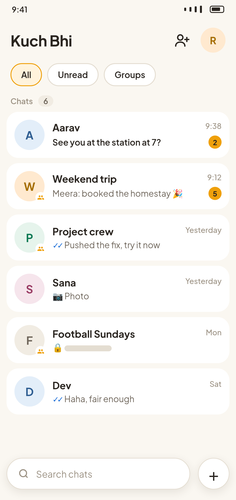
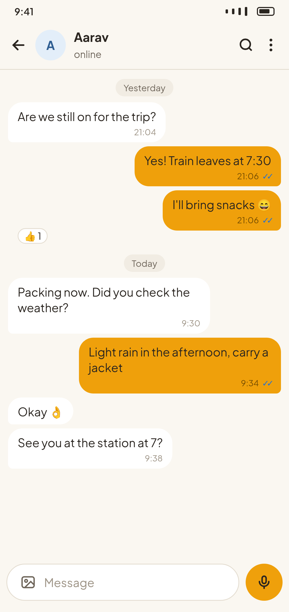

# Kuch Bhi

**An end-to-end encrypted messaging app for a closed group of friends**, with a self-hosted backend on an Oracle Cloud VM. Flutter, 2026, in active development.

 

*Mockups with demo names and messages, drawn from the app's real design.*

## The problem

I wanted a chat app for friends where the server can't read the messages, that works offline, and that I host myself. Doing that properly means handling the hard parts: key exchange, group keys that change when people join or leave, and a backend whose rules stop one user reading another's data.

## Design

```
Flutter app (Android)                         Oracle Cloud Always Free (Ubuntu, Ampere)
 ├─ UI ─ Riverpod ─ repositories               ├─ PocketBase (auth, realtime, API rules)
 ├─ Drift / SQLite (offline-first store)  ◄──► ├─ JS hooks (membership, deletion, media expiry)
 └─ crypto in a background isolate             └─ Python FCM notifier (systemd service)
    X25519 key exchange + AES-256-GCM            Firebase Cloud Messaging · Google sign-in
```

- **Offline-first:** messages load from the local database at once and sync in the background.
- **Crypto off the main thread** so the UI never stutters.
- **Delivery and read receipts** as a state machine (sent → delivered → read).
- Media sharing with server-side expiry.

**Stack:** Flutter, Dart, Riverpod, Drift/SQLite, go_router, dio, PocketBase, Firebase Cloud Messaging, Google OAuth, Python, Oracle Cloud Infrastructure.

## What is secured, and how

- **End-to-end encryption.** X25519 key agreement and AES-256-GCM; the server only stores ciphertext.
- **Group key rotation.** New key versions go only to current members, so removed members can't read future messages; old versions are kept so current members can still read history after a cold start.
- **Server-side authorisation.** PocketBase API rules and hooks enforce chat membership, "delete for everyone" and former-member access on the server, not just in the app. Each rule change has a dry-run and a live check script (`docs/server/tests/`).
- **Two security audits of my own code** (30 Oct and 16 Nov 2026), covering client crypto, local data, network and auth, server rules, Android and secrets. Confirmed findings were fixed and re-tested on a device. One example: a QR-code path could pass unvalidated text into a server query filter; it is now validated at the repository boundary.
- **Hardened VM.** SSH with keys only; a host firewall; administrative access only from my own devices over a Tailscale private network; Oracle Cloud ingress rules tightened to match.
- **Secrets kept out of the repo.** Server credentials live in a `chmod 600` environment file loaded by systemd, never in the repository.

## Run it

```bash
flutter pub get
dart run build_runner build --delete-conflicting-outputs
flutter run
```

You need your own PocketBase server and a Firebase project (`google-services.json`). Server hooks are in `docs/server/hooks/`.


Built by Chaitanya Dhotre.
